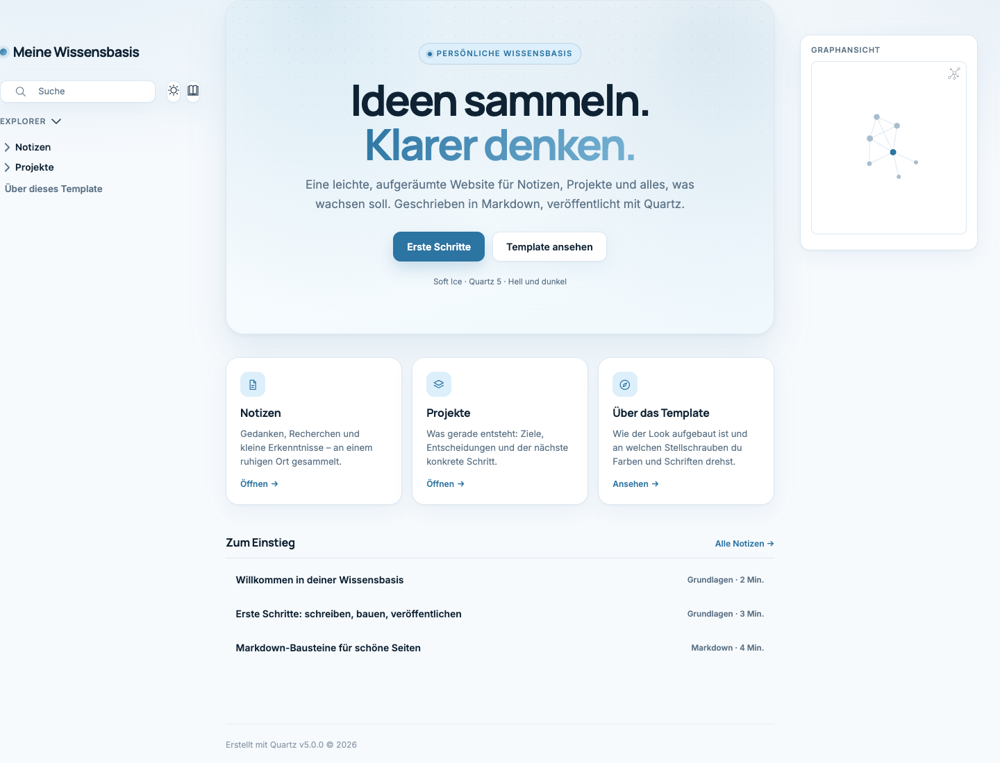
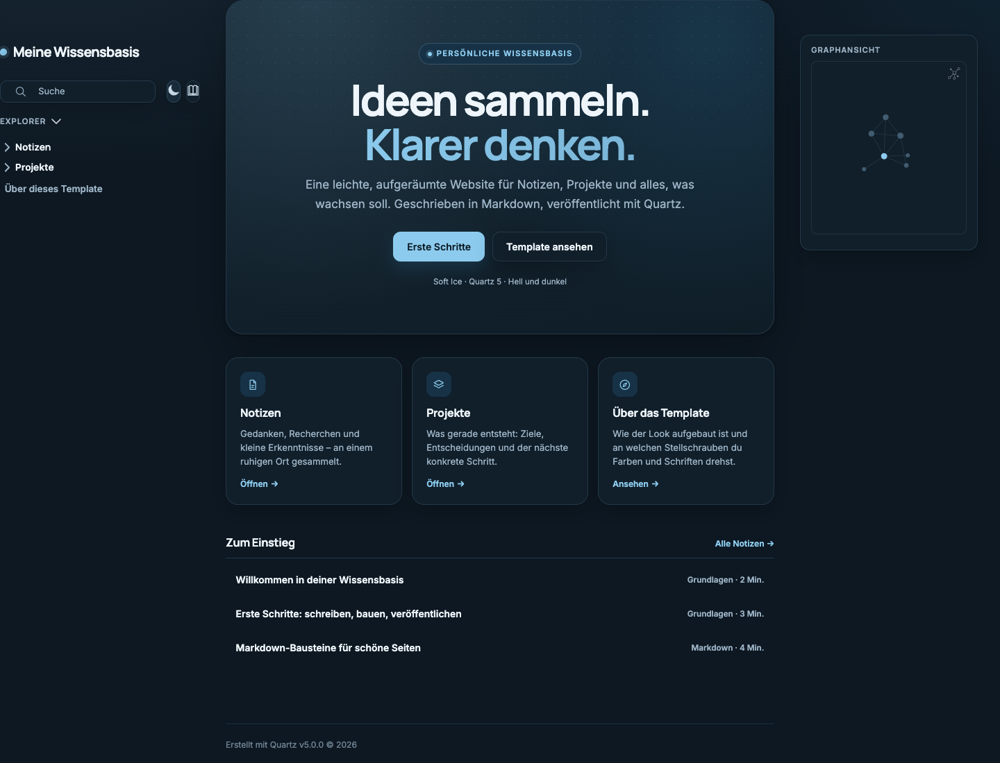

# Soft Ice — ein Quartz-5-Template

Eine ruhige, leichtblaue Wissensbasis für [Quartz 5](https://quartz.jzhao.xyz). Das Template ist als vollständiges Starter-Projekt angelegt: Startseite, Beispielnotizen, Suche, Explorer, Graph, Backlinks, Inhaltsverzeichnis und Dunkelmodus funktionieren sofort.



## Voraussetzungen

- **Node.js 22 oder neuer**
- **npm 10.9.2 oder neuer**

Mit nvm:

```bash
nvm install 22
nvm use 22
node -v
```

## Starten

```bash
npm ci
npx quartz plugin install --from-config
npx quartz build --serve
```

Die Seite läuft danach unter <http://localhost:8080>. Änderungen an Inhalten und Styles werden automatisch neu gebaut.

Wenn Port 8080 bereits belegt ist:

```bash
npx quartz build --serve --port 8081
```

## Aufbau

```text
.
├── content/                  # Deine Notizen und Seiten
│   ├── index.md              # Startseite mit Hero und Karten
│   ├── ueber.md              # Beschreibung des Templates
│   ├── notizen/              # Beispielbereich
│   └── projekte/             # Beispielbereich
├── quartz/
│   ├── styles/
│   │   └── custom.scss       # Soft-Ice-Design über Quartz hinaus
│   └── static/
│       └── icon.png          # Favicon (512 × 512)
├── quartz.config.yaml        # Titel, Farben, Schriften, Plugins, Layout
├── quartz.ts                 # Lädt YAML-Konfiguration und Layout
└── package.json
```

## Anpassen

### Titel und Adresse

In `quartz.config.yaml`:

```yaml
configuration:
  pageTitle: Meine Wissensbasis
  locale: de-DE
  baseUrl: localhost:8080
```

`baseUrl` enthält kein `https://` und keinen abschließenden Slash. Für GitHub Pages zum Beispiel `username.github.io/mein-repo`.

### Farben

Die Grundpalette steht unter `theme.colors`. Quartz leitet daraus Links, Rahmen, Graph und Hervorhebungen ab.

```yaml
colors:
  lightMode:
    light: "#F7FAFD"      # Seitenhintergrund
    lightgray: "#DCE8F2"  # Rahmen
    gray: "#A8BECE"       # Graph-Kanten
    darkgray: "#33475B"   # Fließtext
    dark: "#0F2233"       # Überschriften und Icons
    secondary: "#2C74A2"  # Links
    tertiary: "#1F648E"   # Hover
```

Die zusätzlichen Flächen, Radien und Schatten der Startseite liegen als Design-Tokens am Anfang von `quartz/styles/custom.scss`:

```scss
:root {
  --si-surface: #ffffff;
  --si-border: #dce8f2;
  --si-primary: #2c74a2;
  --si-radius: 16px;
}
```

Der Dunkelmodus verwendet dieselben Tokens unter `[saved-theme="dark"]`.

### Schriften

Schriften werden an zwei Stellen gesetzt und sollten dort gleich bleiben:

1. `theme.typography` lädt die Familien von Google Fonts.
2. Der `quartz-fonts`-Plugin-Eintrag setzt die tatsächlich verwendeten CSS-Variablen.

```yaml
theme:
  typography:
    title: Manrope
    header: Manrope
    body: Inter
    code: JetBrains Mono
```

```yaml
plugins:
  - source: "@quartz-community/quartz-fonts"
    enabled: true
    options:
      useThemeFonts: false
      fontOrigin: googleFonts
      title: '"Manrope", system-ui, sans-serif'
      header: '"Manrope", system-ui, sans-serif'
      body: '"Inter", system-ui, sans-serif'
      code: '"JetBrains Mono", monospace'
```

Für eine vollständig lokale Auslieferung `fontOrigin: local` setzen und die Schriften selbst bereitstellen.

### Inhalte

Jede Markdown-Datei in `content/` wird zu einer Seite. Ordner erhalten automatisch eine Übersichtsseite, Tags erhalten eigene Sammlungen.

```markdown
---
title: Neue Notiz
description: Worum es geht.
tags:
  - ideen
---

Der Text beginnt hier.
```

Interne Verweise funktionieren mit `[[dateiname]]` oder `[[dateiname|Eigener Text]]`.

### Startseite

`content/index.md` enthält den Hero und die Karten als HTML mit den Klassen `si-hero`, `si-card` und `si-list`. Die Gestaltung liegt in `custom.scss` unter „Landing page“. Titel und Beschreibung der Seite stehen im Frontmatter.

### Navigation und Layout

Die Reihenfolge der Seitenleisten, der Graph, das Inhaltsverzeichnis und die Backlinks werden in `quartz.config.yaml` unter `plugins` über `layout.position` und `layout.priority` gesteuert. Die Startseite blendet den Seitentitel per CSS aus, damit der Hero die Führung übernimmt.

### Favicon

`quartz/static/icon.png` durch ein eigenes quadratisches Bild (mindestens 512 × 512) ersetzen. Der Favicon-Plugin-Schritt erzeugt daraus das Icon.

## Veröffentlichen

1. `baseUrl` auf die spätere Adresse setzen.
2. optional ein Git-Remote eintragen.
3. bauen und veröffentlichen:

```bash
npx quartz sync
```

Der statische Build liegt in `public/` und kann auch bei Cloudflare Pages, Netlify oder Vercel hochgeladen werden. Hinweise: [Quartz Hosting](https://quartz.jzhao.xyz/hosting).

## Dunkelmodus

Der Umschalter in der Seitenleiste wechselt zwischen der hellen Palette und dem marineblauen Dunkelmodus. Die Auswahl wird im Browser gespeichert.



## Barrierefreiheit

- Kontrastwerte der Text- und Linkfarben orientieren sich an WCAG AA.
- Sichtbare Fokus-Ringe für Tastaturnutzung.
- `prefers-reduced-motion` reduziert Animationen.
- Semantische Überschriften und alternative Texte für Icons.

## Lizenz

Das Template basiert auf [Quartz](https://github.com/jackyzha0/quartz) von Jacky Zhao und steht wie Quartz unter der MIT-Lizenz. Die Beispielinhalte kannst du frei ersetzen.
